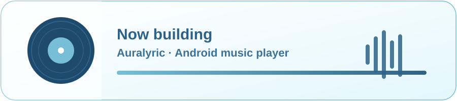
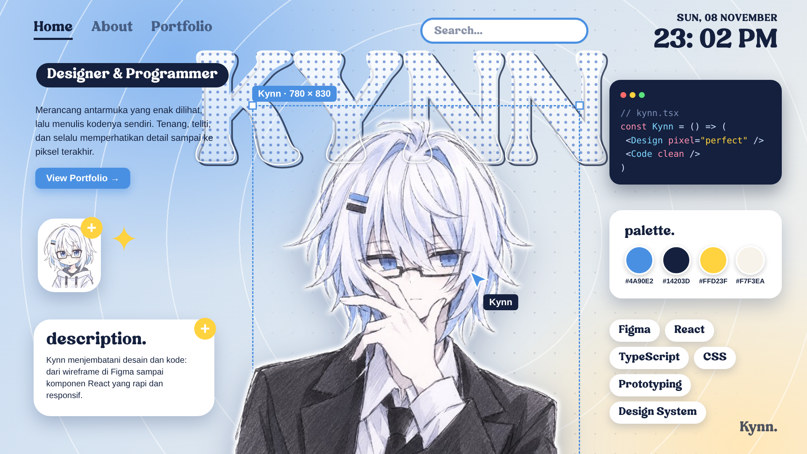

 

 

## 👋 About

I design and build software with a focus on how it feels to use: clear interfaces, smooth motion, and details that make a product feel finished.

My current main project is **Auralyric**, a music player for Android with synced lyrics, custom icons, and a developer playground inside the app.

## 🎯 Currently

- 🎵 Building **Auralyric**, a refined Android music player
- 📦 Shipping releases through **Auralyric App**, a download page for the latest APK
- 🎨 Working on UI motion and visual identity for the app

## 🧰 Skills

<table>
<tr>
<td align="center" width="50%">

### 🎨 Design
UI/UX · Product design · Motion · Visual identity

</td>
<td align="center" width="50%">

### 💻 Engineering
Android · Kotlin · Compose · Build & release

</td>
</tr>
</table>

## 📂 Featured repositories

| Repository | What it is |
|---|---|
| [**Auralyric**](https://github.com/kenza11-star/Auralyric) | The Android music player, source code and CI build |
| [**Auralyric-app**](https://github.com/kenza11-star/Auralyric-app) | Download page and latest APK releases |
| [**Other repositories**](https://github.com/kenza11-star?tab=repositories) | Everything else I've been working on |

## 📊 GitHub stats

Updated automatically every 12 hours from the GitHub API.

  
  

Auralyric is licensed under GPL-3.0 · Made with care in Indonesia 🇮🇩

